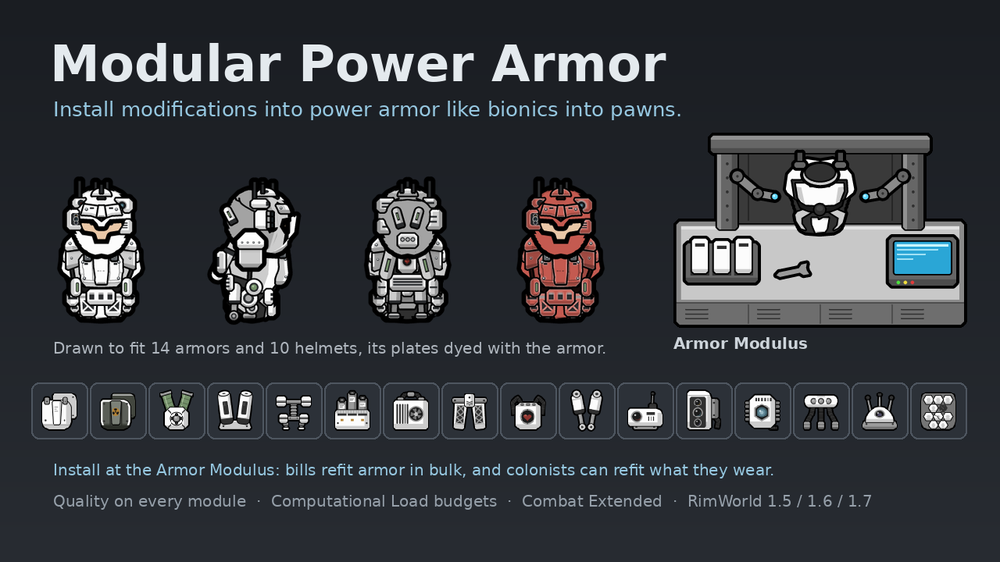

# Modular Power Armor

A RimWorld mod (1.5, 1.6 and 1.7) that lets you install modifications into power armor the way you install bionics into pawns. Each armor piece has a **Computational Load** budget. Every modification costs some of it, comes in qualities like weapons and armor, and many of them show up on the pawn wearing them. Armor is refitted at the **Armor Modulus** workbench.

Requires [Harmony](https://steamcommunity.com/sharedfiles/filedetails/?id=2009463077). Combat Extended is fully supported.



## Supported armor

Armor from DLCs or mods you don't have is skipped automatically, with no errors.

| Armor | Body def / helmet def | Source | Computational load (body / helmet) |
|---|---|---|---|
| Marine | `Apparel_PowerArmor` / `Apparel_PowerArmorHelmet` | Core | 10 / 6 |
| Recon | `Apparel_ArmorRecon` / `Apparel_ArmorHelmetRecon` | Core | 12 / 7 |
| Cataphract | `Apparel_ArmorCataphract` / `Apparel_ArmorHelmetCataphract` | Royalty | 9 / 6 |
| Locust | `Apparel_ArmorLocust` (uses the recon helmet) | Royalty | 11 |
| Phoenix | `Apparel_ArmorCataphractPhoenix` (uses the cataphract helmet) | Royalty | 9 |
| Grenadier | `Apparel_ArmorMarineGrenadier` (uses the marine helmet) | Royalty | 10 |
| Prestige marine | `Apparel_ArmorMarinePrestige` / `Apparel_ArmorMarineHelmetPrestige` | Royalty | 12 / 7 |
| Prestige recon | `Apparel_ArmorReconPrestige` / `Apparel_ArmorHelmetReconPrestige` | Royalty | 14 / 8 |
| Prestige cataphract | `Apparel_ArmorCataphractPrestige` / `Apparel_ArmorHelmetCataphractPrestige` | Royalty | 11 / 7 |
| Prestige locust | `Apparel_ArmorLocustPrestige` | Vanilla Prestige Specialist Armours Reworked / Prestige Specialist Armor | 13 |
| Prestige phoenix | `Apparel_ArmorPhoenixPrestige` | Vanilla Prestige Specialist Armours Reworked / Prestige Specialist Armor | 11 |
| Prestige grenadier | `Apparel_ArmorGrenadierPrestige` | Vanilla Prestige Specialist Armours Reworked / Prestige Specialist Armor | 12 |
| Siegebreaker | `VAE_Apparel_HeavyMarineArmor` / `VAE_Headgear_HeavyMarineHelmet` | Vanilla Armour Expanded | 9 / 6 |
| Prestige siegebreaker | `VAE_Apparel_RoyalSiegeArmor` / `VAE_Headgear_RoyalSiegeHelmet` | Vanilla Armour Expanded + Royalty | 11 / 7 |
| Trooper | `VAE_Apparel_TrooperArmor` / `VAE_Headgear_TrooperHelmet` | Vanilla Armour Expanded | 10 / 6 |
| Prestige trooper | `VAE_Apparel_RoyalTrooperArmor` / `VAE_Headgear_RoyalTrooperHelmet` | Vanilla Armour Expanded + Royalty | 12 / 7 |
| Privateer | `VFEP_Apparel_Privateer` (no separate helmet) | Vanilla Factions Expanded - Pirates | 10 |

Every def name above was checked against Combat Extended's compatibility patches for those mods. The list lives in [`Defs/Targets/MPA_ArmorTargets.xml`](Defs/Targets/MPA_ArmorTargets.xml).

## Computational load

- Each armor piece has its own **Computational Load** stat, shown in its info card. Helmets and body armor have separate onboard computers, so they have separate budgets.
- Each modification has a **computational load cost**. The total cost of a piece's modifications can't exceed its computational load.
- The auxiliary subpersona raises a piece's computational load and costs nothing itself. You can't remove it if the remaining modifications wouldn't fit without it.
- The second mind raises the load of its helmet **and** of the body armor worn with it. If that helmet comes off, body armor that needs the extra load is **overloaded**: its modifications stop working (their visuals stay) until the helmet is back on or enough load is freed. The armor's inspect pane and info card say when a piece is overloaded.
- Each modification can only be installed once per piece, and the two kinds of plating can't share a piece.

## Modifications

Values are at Normal quality.

| Modification | Fits | Load | Effect | Combat Extended |
|---|---|---|---|---|
| Additional plating | Body + helmet | 2 | Piece: +20% sharp armor, +9% blunt armor | +4 mm RHA sharp, +9 MPa blunt |
| Uranium composite plating | Body + helmet | 3 | Piece: +55% sharp armor, +25% blunt armor. Wearer: x80% move speed, a drawback that better quality lessens. Can't share a piece with additional plating | +11 mm RHA sharp, +25 MPa blunt |
| Bionic synchronization | Body + helmet | 3 | Other modifications on the same piece are 2% stronger per bionic-grade (spacer or better) implant in the wearer | Same |
| Thermal regulation unit | Body + helmet | 1 | Wearer: min comfortable temperature -8°C, max +8°C | Same |
| Ablative heat shielding | Body + helmet | 1 | Piece: +15% heat armor, x50% flammability | Same (CE heat armor is still a percentage) |
| Neuromemetic regenerators | Body + helmet | 2 | On the body parts the piece covers and the organs inside them: x50% pain, heals 6 injury damage a day (scars included), tends a random bleeding wound every 15 seconds at 80% quality | Same |
| Auxiliary subpersona | Body + helmet | 0 | Piece: +3 computational load | Same |
| Neural stress dampener | Body + helmet | 2 | Wearer: -8% mental break threshold | Also x50% suppressability |
| Targeting uplink | Helmet | 3 | Wearer: x85% aiming time | Also +10% aiming accuracy |
| Multispectral sensor array | Helmet | 2 | Wearer: x115% sight, and sees through blindness, darkness, fog and smoke | Same, including CE's darkness, weather and smoke aiming penalties |
| Second mind | Helmet | 0 | Wearer: x120% consciousness. Piece: +4 computational load, and +4 for the body armor worn with it | Same |
| Biogel servo replacement | Body | 3 | Wearer: x120% manipulation, x110% move speed | Same |
| Load-bearing exoframe | Body | 2 | Wearer: x125% carrying capacity, x110% melee damage | Also +25 kg carry weight, +5 bulk |
| Rigidity matrix | Body | 4 | Wearer: can't be staggered, x75% damage taken | Same (CE's melee stagger too) |
| Second heart | Body | 4 | Refuses the wearer's death once, when their head is destroyed. No quality | Same |
| Longjump hydraulics | Body | 3 | The wearer can leap up to 20 cells, over walls and through roofs. Recharges in 3 hours | Same |

Non-player pawns' armor has a 20% chance per piece to come with one to three modifications, so you can also loot them (never a second heart or a second mind).

### Research and recipes

- **Armor Modification** branches off **Marine armor** (hi-tech research bench with a multi-analyzer, 3000). It unlocks the Armor Modulus and every modification except the four below.
- **Advanced Modules** follows it (4500) and unlocks neuromemetic regenerators, uranium composite plating, the second heart and the second mind.

Both projects sit right next to marine armor in the research tree; their place is worked out when the game loads, so they stay beside it even if another mod moves it.

Modifications are crafted at a **fabrication bench**, and Crafting skill decides their quality, as it does for weapons and armor. Every modification costs 30-50 plasteel, 2 components and 1-4 advanced components, plus its own materials:

| Modification | Plasteel | Components | Advanced components | Also |
|---|---|---|---|---|
| Additional plating | 50 | 2 | 1 | 15 uranium |
| Uranium composite plating | 50 | 2 | 2 | 40 hyperweave, 80 uranium |
| Bionic synchronization | 30 | 2 | 3 | 15 gold |
| Thermal regulation unit | 30 | 2 | 1 | 40 steel |
| Ablative heat shielding | 30 | 2 | 1 | 20 silver |
| Neuromemetic regenerators | 40 | 2 | 3 | 4 industrial medicine |
| Auxiliary subpersona | 30 | 2 | 1 | 10 gold, 3 basic subcores |
| Neural stress dampener | 30 | 2 | 2 | 10 gold |
| Targeting uplink | 30 | 2 | 2 | 5 gold |
| Multispectral sensor array | 30 | 2 | 2 | 25 silver |
| Second mind | 40 | 2 | 5 | 1 AI persona core |
| Biogel servo replacement | 40 | 2 | 2 | 3 industrial medicine |
| Load-bearing exoframe | 40 | 2 | 1 | 60 steel |
| Rigidity matrix | 50 | 2 | 3 | |
| Second heart | 40 | 2 | 2 | 1 human heart, 3 high subcores |
| Longjump hydraulics | 50 | 2 | 3 | |

The second mind keeps the 5 advanced components it was designed with. Subcores come from Biotech; without them, the auxiliary subpersona and the second heart take 4 advanced components in total instead.

### Neuromemetic regenerators

Everything they do is limited to the body parts their armor piece covers and the organs inside them, so regenerators in body armor look after the torso, arms and legs, and regenerators in a helmet look after the head.

- Pain from injuries and conditions on those parts is halved.
- Every 10 seconds, a random injury there heals a little (6 damage a day at Normal quality, on top of natural healing). Permanent injuries such as scars heal too.
- Every 15 seconds, one random bleeding wound there is tended at 80% quality (higher with better quality, up to 100%).

### Multispectral sensor array

- The wearer's sight never drops below what the sensor gives a sighted wearer (x115% at Normal quality), so missing eyes, blinded eyes and blinding effects don't matter.
- No work speed penalty in the dark, and no "in darkness" mood penalty.
- Weather, smoke and darkness don't affect the wearer's ranged accuracy. With Combat Extended, the sensor clears CE's darkness, weather and smoke shifts instead.

### Second heart

- If the wearer's head is destroyed (or the neck, taking the head with it), the second heart refuses their death, as long as nothing else would kill them: bleeding out, a destroyed heart or torso, or any other fatal wound still kills.
- The pawn is kept alive at 50% consciousness. All of their wounds are tended, their pain is cut to 20%, and they get x150% move speed for 12 hours.
- A red (critical) **Death Refused: _name_** alert appears in the corner. Its description is the killing blow and the time left.
- Two days later the pawn dies, unless the head has been restored somehow (a healer mech serum, a regeneration mod, ...). The alert clears as soon as the head is back.
- It works once. The module is then **spent**: it does nothing, and is thrown away when it is removed. Install a new one.
- It has no quality, so it always works the same.

### Longjump hydraulics

- The wearer gets a **Longjump** button (drafted or not). Pick a spot within range to leap there.
- Leaps go over walls and through constructed roofs, but not through mountains: natural rock or an overhead mountain anywhere along the way, including where the leap starts and ends, blocks it. You can't land on a spot that's occupied (by a pawn or anything you couldn't stand on) or that you can't see.
- Range is 20 cells and the recharge time 3 hours at Normal quality. Better quality leaps farther and recharges faster: 14 cells and 4.3 hours at Awful, 32 cells and 1.9 hours at Legendary. The button shows the recharge.

### Rigidity matrix

Hits don't stagger the wearer (vanilla slows pawns hit by bullets; Combat Extended staggers on melee hits), and the wearer takes x75% damage, scaling with quality like other factors.

## Quality

Each quality tier above or below Normal changes a modification's effects by 15% (configurable in the mod settings):

- **Offsets** (armor, temperature, load bonus, ...) are multiplied by the effect strength.
- **Factors** have their distance from 100% multiplied, so a x115% bonus becomes x117.25% at Good quality.
- **Drawbacks** (the uranium plating's move speed) work the other way round: their distance from 100% is divided by the effect strength, so better quality makes them smaller. x80% becomes x71% at Awful and x87.5% at Legendary.
- The second heart has no quality.

| Quality | Effect strength | Biogel servo: manipulation / move speed | Additional plating: sharp / blunt (vanilla) | Additional plating (CE) | Uranium plating: move speed |
|---|---|---|---|---|---|
| Awful | 70% | x114% / x107.0% | +14% / +6.3% | +2.8 mm RHA / +6.3 MPa | x71.4% |
| Poor | 85% | x117% / x108.5% | +17% / +7.6% | +3.4 mm RHA / +7.6 MPa | x76.5% |
| Normal | 100% | x120% / x110.0% | +20% / +9.0% | +4.0 mm RHA / +9.0 MPa | x80.0% |
| Good | 115% | x123% / x111.5% | +23% / +10.3% | +4.6 mm RHA / +10.3 MPa | x82.6% |
| Excellent | 130% | x126% / x113.0% | +26% / +11.7% | +5.2 mm RHA / +11.7 MPa | x84.6% |
| Masterwork | 145% | x129% / x114.5% | +29% / +13.1% | +5.8 mm RHA / +13.0 MPa | x86.2% |
| Legendary | 160% | x132% / x116.0% | +32% / +14.4% | +6.4 mm RHA / +14.4 MPa | x87.5% |

Bionic synchronization multiplies on top of quality. For example, a Legendary plating on a piece with a Normal synchronizer and a wearer with 5 bionics applies at 160% x 110% = 176% strength. Synchronization doesn't affect computational load bonuses, because otherwise removing an implant could overload the armor.

## The Armor Modulus

A 3x2 powered workbench (Production tab, **Armor Modification** research; 150 steel, 60 plasteel, 6 components, 2 advanced components; 250 W).

- **Bills.** There is an **Install _modification_** bill for every modification, and a **Strip all modifications** bill. A colonist brings a piece of armor (and the modification) to the station, and the finished armor comes back out as the bill's product, so it is hauled away like anything else crafted. Stripped modifications come out alongside it. Use "Do X times" to refit armor in bulk, and the bill's ingredient filter to choose which armor types, qualities and hit points it works on. Armor only counts as an ingredient when the bill can do something with it: the modification has to fit the piece and its free load, and must not already be installed (or, for stripping, there has to be something to strip).
- **Worn armor.** Right-click the station with a colonist selected and choose **Modify _name_'s worn armor here**. A window shows the armor they are wearing with its load, armor values and installed modifications, the modifications on the map that would fit, and the colonist's stats and special effects. Install and remove buttons queue the work, which the colonist does at the station while wearing the armor.
- **Armor on the ground** can still be modified where it lies: select a colonist and right-click the armor.

Worn armor can't be modified anywhere but at an Armor Modulus. Installing or removing by hand takes about 10 seconds, scaled by the worker's general labor speed; any colonist who can manipulate can do it. Removed modifications keep their quality and hit points, and armor that is destroyed or smelted drops its modifications.

Wearer effects are applied through an **armor modifications** health condition, so they show up in the health tab and in every stat breakdown; its tooltip also lists the special effects. Armor effects show in the armor's own stat breakdown.

## Visuals

Modifications with a visual are drawn on the pawn through RimWorld's render tree, so they also show in portraits and the colonist bar:

| Piece | Modification | What it looks like |
|---|---|---|
| Body | Additional plating | A thick appliqué slab with a raised keel clamped over the chest, and layered pauldrons over the shoulders where the armor's own features leave room; from the side the near pauldron is the same size as from the front, in front of the helmet's lower edge. On the siegebreaker the pauldrons lie on its own sloping shoulder blocks; on the phoenix they sit over the wing roots, and from behind the jump pack hides the left one. On female and thin bodies the pauldrons keep their full size and reach so they show past the helmet, and the slab is wider |
| Body | Uranium composite plating | The same places, heavier: dark uranium-ceramic slabs in dyed trim, a trefoil on the chest |
| Body | Biogel servo replacement | Rounded servo housings over the outside of both elbows, with a window onto the biogel |
| Body | Neuromemetic regenerators | Two canisters out of the upper back, angled down and outwards, with a window onto the gel |
| Body | Second heart | An armored housing in the middle of the upper back, the heart behind a porthole |
| Body | Auxiliary subpersona | A case over the belt buckle with three subcore cartridges slotted into it |
| Body | Load-bearing exoframe | A frame that carries the whole armor: a spine on the back with a yoke over the shoulders and a hip belt, big actuators on the hips, and struts down the outside of the legs to the knees and feet |
| Body | Rigidity matrix | A braced plate over each thigh: a cross strut in a lattice window, with a lock bar across the top |
| Body | Thermal regulation unit | A radiator plate with vent slits across the lower back |
| Body | Longjump hydraulics | A heavy ram down the back of each leg, from under the lower back to a pivot at the heel |
| Helmet | Additional plating | A brow guard: a thick visor hood across the upper face. On cataphract and siegebreaker helmets (the phoenix wears the cataphract helmet), a great-helm faceplate instead: two broad, thick plates that slope back from a hard edge, upright in front of the face and rising to a point over the brow, covering the front from ear to ear, bolted along their back edges. On siegebreaker helmets a black camera port on the left side of the face, three lenses looking straight ahead out of it like the helmet's own |
| Helmet | Uranium composite plating | A heavier, dark brow guard in dyed trim. On cataphract and siegebreaker helmets, the great-helm faceplate in dark, laminated uranium plates framed in dyed trim, with a trefoil on one plate (on siegebreaker helmets, the camera port on the other side) |
| Helmet | Targeting uplink | A rangefinder housing with a whip antenna high on the right side |
| Helmet | Multispectral sensor array | A pod built out of the side of the helmet under the uplink, three cameras stacked in its window: thermal, visible and ultraviolet. On cataphract and siegebreaker helmets it sits in front of the faceplate, so its cameras look out past it |
| Helmet | Second mind | A persona core housing at the left temple, the core behind a round port |
| Helmet | Auxiliary subpersona | A housing under the second mind with three subcore cartridges |
| Helmet | Neuromemetic regenerators | Two canisters on the back of the helmet, angled up and apart |
| Helmet | Bionic synchronization | A spinal interface socket at the nape with three plugs seated in it |
| Helmet | Neural stress dampener | A low emitter dome with three stub antennas on the crown |

- **Built like the armor.** Apart from the plating, every module is drawn the way the vanilla armor is: a few big plates with flat faces, chamfered edges, dark recesses and black outlines, so the pawn stays readable with many modules installed.
- **The art is drawn for each armor.** Every armor has its own set (14 body armors x 5 body types x 3 facings, 10 helmets x 3 facings) at 256x256, double vanilla's resolution, placed using measurements of that armor's own worn textures. Modules move clear of launchers, wings, jump packs, gold trim, horns and antennas, and they hug slim armor like the trooper's as closely as the bulky siegebreaker.
- **It is drawn as one 3D object.** Every module is placed on a 3D model of the pawn, so it is in the same place in every view: the exoframe's frame runs down the back and its struts down the outside of the legs, its hip and knee joints are round only from the side, where their axles face you, and a pair of canisters seen from the side shows as one. Facing west RimWorld mirrors the east view, so art that differs from side to side gets a west view of its own: from the right you see the uplink and sensor array, from the left the second mind, the subpersona and the siegebreaker faceplate's camera port, and one-sided pauldrons and exoframe yokes (grenadier, privateer) show only from their side.
- **Modules layer, they don't clip.** Each module has its place and a fixed drawing order, so where two meet (the subpersona over the rigidity matrix, the longjump rams over the exoframe's hip belt) the upper one covers the lower one cleanly, and any combination can be installed at once. The great-helm faceplate on cataphract and siegebreaker helmets goes in front of every other helmet module but the sensor array, and the platings' side-view pauldrons go in front of the head. Where an armor's own features take a module's place in one view, the module is left out of that view, or, for the exoframe, its shoulder goes under the wing or pauldron.
- **Only while the armor shows.** A modification is drawn only while the armor piece it is installed in is drawn, so hidden headgear and mods that hide apparel hide its modifications too.
- **Its plates are dyed with the armor.** The art comes with CutoutComplex masks: the parts built like the armor's shell take the armor's color, while frame members, rods, recesses and optics keep their own grey, black and glass.

Each visual is drawn just above the armor piece it's installed in and below the next apparel layer. You can turn visuals off in the mod settings.

The art is generated with [rwtexturegen](https://github.com/Jitby-Jones/rwtexturegen) from the specs in [`Source/TextureSpecs`](Source/TextureSpecs):

- `modules.py` draws the worn art, using the drawing kit in `mpa_kit.py` and the armor measurements in `mpa_fit.py`; `build_art.py` renders it into `Textures`.
- `module_icons.py` draws the item and UI icons.
- `armor_modulus.py` draws the Armor Modulus.
- `armor_profiles.json` holds the measured silhouettes. These are numbers only: no art from RimWorld or other mods is included. `measure_profiles.py` regenerates the file from your own copies of the armor textures.

For your own art, set a render node's `texPath` with a `{fit}` token. It is replaced by the armor's fit, and Marine is used if that fit has no art. Body nodes use `bodyTypeTextures` (`_Male`, `_Female`, `_Thin`, `_Fat`, `_Hulk`), with `_north`, `_south` and `_east` versions of each file; any square size works (the mod's own art is 256x256). Nodes use the CutoutComplex shader in the armor's colors by default, so each texture needs a mask (`_northm`, `_southm`, `_eastm`; the mod's are half size) whose red marks what takes the armor's color. `layerFraction` places a node between its armor piece (0) and the next apparel layer (1), and `layerFractionByFit` (a list of `fit` and `layerFraction`) overrides it on armor of particular fits; `aboveHead` draws a body node over the head and everything on it instead, for parts that stand out past the head. For unmasked art dyed all over, set `shaderTypeDef` to `Cutout`; set `useArmorColor` to `false` for art that keeps its own colors. The west view mirrors the east texture, unless you add a `_west` texture (with its `_westm` mask) drawn facing west for art that differs from side to side; the mod draws that one as it is.

## Combat Extended

The `Mods/CombatExtended` folder only loads when CE is active:

- Armor bonuses switch to CE's units (mm RHA and MPa). They go onto the armor piece's own stat, which CE reads, so CE's partial armor multipliers still apply.
- All modification items get CE bulk.
- Some modifications gain CE-only effects: the stress dampener halves suppressability, the targeting uplink adds aiming accuracy, and the exoframe adds carry weight and bulk.
- The multispectral sensor array clears darkness, weather and smoke from CE's aiming report (in the mod's code, so nothing changes without CE). Apparel night vision itself is left alone, because CE caches it per armor type and quality.

## Harmony patches

Most effects are plain stats and hediffs. These need Harmony:

| Patch | For |
|---|---|
| `PawnCapacityUtility.CalculateCapacityLevel` (postfix) | Sensor array sight floor; second heart consciousness and breathing (hediff offsets can't raise a capacity from zero) |
| `Pawn.Kill` (prefix) | Second heart |
| `StaggerHandler.StaggerFor` (prefix) | Rigidity matrix |
| `ShotReport.HitReportFor`, `StatPart_Glow.ActiveFor`, `ThoughtWorker_Dark.CurrentStateInternal` (postfixes) | Sensor array: weather, smoke and darkness |
| `Bill.IsFixedOrAllowedIngredient`, `GenRecipe.MakeRecipeProducts` (postfixes) | Armor Modulus bills |
| CE's `Verb_LaunchProjectileCE.ShiftVecReportFor` (postfix, only with CE) | Sensor array under CE |

Each patch is applied on its own, so if a game update breaks one, the rest keep working and the error names the broken one.

## Adding your own armor or modifications

To support more armor, add a `ModularArmorTargetDef` in your own mod (no C# needed):

```xml
<ModularPowerArmor.ModularArmorTargetDef>
  <defName>MyMod_ModularTargets</defName>
  <label>my armor</label>
  <targets>
    <li><defName>MyArmor</defName><slot>Body</slot><computationalLoad>10</computationalLoad><fit>Marine</fit></li>
  </targets>
</ModularPowerArmor.ModularArmorTargetDef>
```

`fit` picks the module art drawn on that armor. Use the closest of the shapes listed in [`MPA_ArmorTargets.xml`](Defs/Targets/MPA_ArmorTargets.xml); Marine is the default.

A modification is any `ThingDef` with an `MPA_ComputationalLoadCost` stat and a `ModularPowerArmor.CompProperties_ArmorModule` comp, usually with `CompQuality` too; see [`Defs/Modules`](Defs/Modules) for examples. Available fields:

- `slots`, `exclusionTags` (modifications sharing a tag can't share a piece), `generateOnNpcs`
- `wearerStatOffsets`, `wearerStatFactors`, `wearerStatPenaltyFactors` (drawbacks that better quality lessens), `wearerCapacityModifiers`, `wearerPainFactor`, `wearerBleedFactor`
- `coveredPainFactor`, `coveredHealPerDay`, `coveredTendIntervalTicks`, `coveredTendQuality` (the body parts the host piece covers)
- `seeThroughObscurement`, `preventStagger`, `refuseDeath`, `longjump` (`range`, `cooldownTicks`)
- `armorStatOffsets`, `armorStatFactors`
- `computationalLoadBonus`, `wornComputationalLoadBonus` (for the other pieces worn with it)
- `bionicSyncPerImplant`, `bionicSyncMinTechLevel`
- `installTicks`
- `bodyRenderNodes`, `helmetRenderNodes`

To install it at the Armor Modulus, give it a bill too: copy an install recipe from [`MPA_ModulusRecipes.xml`](Defs/Recipes/MPA_ModulusRecipes.xml) and name your modification in the second ingredient and in the `ArmorModulusRecipe` extension. Which armor the bill accepts is filled in when the game loads.

## Building

```bash
Source/build.sh
```

This builds `1.5/Assemblies`, `1.6/Assemblies` and `1.7/Assemblies` against the `Krafs.Rimworld.Ref` packages and the `Lib.Harmony.Ref` reference assembly, so no RimWorld install is required (the Harmony mod supplies `0Harmony.dll` in game). RimWorld 1.7 runs on .NET 10, so you need the .NET 10 SDK; it also builds the .NET Framework 4.7.2 assemblies for 1.5 and 1.6.

To regenerate the textures, install [rwtexturegen](https://github.com/Jitby-Jones/rwtexturegen) (`pip install -e <path>`) and run:

```bash
cd Source/TextureSpecs
python3 build_art.py
python3 module_icons.py
rwtex build armor_modulus.py --out /tmp/mpa-bench --mod ../..
python3 make_preview.py
```

## Status

The code compiles against the RimWorld 1.5, 1.6 and 1.7 reference assemblies, and every API it calls or patches was checked against all three. All XML was checked for field names (against each version's game code), enum values, cross-references, textures (every armor fit, body type and facing), translation keys, patch targets and the Armor Modulus bills. The module art was checked by compositing it, masks and all, over each supported armor's own textures, for every body type and facing, both one module at a time and all of them together. The mod hasn't been play-tested in the game yet.
